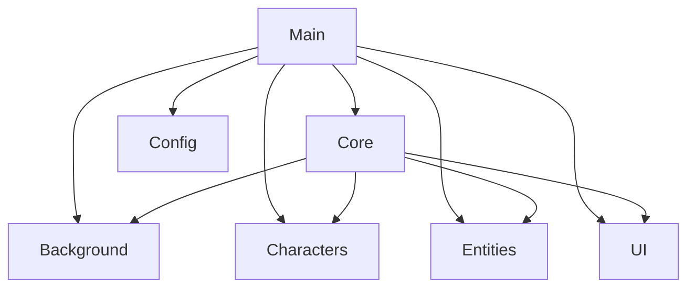

## 1. Stack
- C++17, compiled via `clang++`/Makefile (macOS) or Code::Blocks `.cbp` project (macOS/Windows) — README.md
- OpenGL (fixed-function, GL 1.1-safe primitives) + GLUT/freeglut for windowing, input, timers — src/main.cpp includes `GLUT/glut.h` (Apple) / `GL/glut.h` (other)
- No package manager / no manifest file (package.json, go.mod, pyproject.toml, Cargo.toml all absent at repo root)
- Windows build links `freeglut/opengl32/glu32/winmm/gdi32`; macOS links system GLUT/OpenGL frameworks — README.md

## 2. Directory map
| path | what lives there |
|---|---|
| src/main.cpp | GLUT entry point: window/callback wiring, global engine instances, `--shot` CLI screenshot mode |
| src/Config.h | Shared tuning constants (`cfg::` namespace, e.g. LOGICAL_W, FRAME_MS, SPEED_STEP, MAX_DT, TARGET_ASPECT) |
| src/core/ | GameState, InputManager, Intro (cutscene director) |
| src/background/ | Background, Birds, Monkey, DesertScene, JungleScene, SceneUtil (procedural scenery, no image assets) |
| src/characters/ | Dino, Roshni, Siam, GameCharacters |
| src/entities/ | Dragon, Obstacle, PointsItem |
| src/ui/ | Menu, Score |
| assets/ | background*.png — README states these are no longer used by the game |
| vendor/ | third-party header(s) — README states no longer used by the game |
| trex.cpp | root-level source file, not under src/ — TODO: verify (out of read scope) |
| Dino_Sprint.cbp | Code::Blocks project — Debug/Release targets per OS — README.md |
| Makefile | drives `make run` build — README.md |

## 3. Diagram

## 4. Component index
- [[Main]]
- [[Config]]
- [[Core]]
- [[Background]]
- [[Characters]]
- [[Entities]]
- [[UI]]

## 5. Entry points
- Dev (make): `make run` from repo root — README.md
- Dev (no make): `clang++ -std=c++17 -DGL_SILENCE_DEPRECATION src/*.cpp -o dino_sprint -framework GLUT -framework OpenGL && ./dino_sprint` — README.md
- Dev (debug screenshot mode): `./dino_sprint --shot out.bmp [menu|desert|jungle|intro|introjungle] [secs]` — README.md
- Prod/IDE: open `Dino_Sprint.cbp` at repo root, pick Debug/Release (Windows) or Debug/Release (macOS) target, Build & Run — README.md
- Source entry function: `int main(int argc, char** argv)` in src/main.cpp

## 6. Conventions
- Platform-conditional GLUT include: `#ifdef __APPLE__` → `<GLUT/glut.h>` else `<GL/glut.h>` (src/main.cpp:1-5)
- File-scope global engine instances prefixed `g` (gState, gInput, gBackground, gDino, gRoshni, ... — src/main.cpp:29-42), declared `static`
- GLUT callback functions prefixed `on` (onDisplay, onReshape, onKeyDown, onKeyUp, onSpecial, onMouse, onPassiveMotion, onTimer — src/main.cpp)
- Shared tuning constants centralized in src/Config.h, accessed via `cfg::` namespace (cfg::LOGICAL_W, cfg::FRAME_MS, cfg::SPEED_STEP, cfg::MAX_DT, cfg::TARGET_ASPECT — src/main.cpp)
- One class per `.h`/`.cpp` pair, grouped into role subfolders (background/characters/core/entities/ui) — observed from directory listing
- Error handling on I/O failure: `fprintf(stderr, ...)` + boolean/non-zero return, no exceptions (saveScreenshotBMP, src/main.cpp:98-112)
- Don't regenerate the Code::Blocks project from its GLUT template; use the committed `.cbp` — README.md
- New GL constants beyond 1.1 must be guarded with `#ifndef`+`#define` (Windows/MinGW header gap) — README.md

## 7. Where things go
- New background scenery element → src/background/ (new .h/.cpp pair), wire into Background.cpp's draw/update per README.md
- New playable/cutscene character → src/characters/ (new .h/.cpp pair), instantiate + call init/update/draw from src/main.cpp
- New gameplay entity (obstacle/pickup) → src/entities/ (new .h/.cpp pair), wire into `stepWorld()` and `onDisplay()` in src/main.cpp
- New HUD/menu element → src/ui/ (new .h/.cpp pair), wire `draw()` call into `onDisplay()` in src/main.cpp
- New/adjusted shared tuning value → src/Config.h under the `cfg::` namespace
